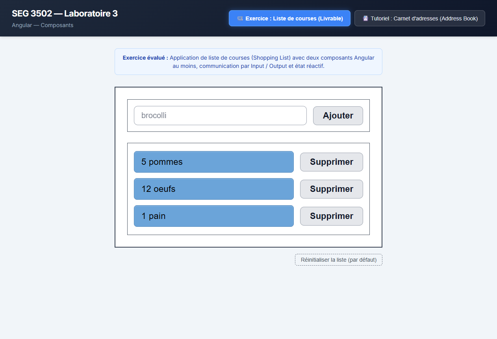
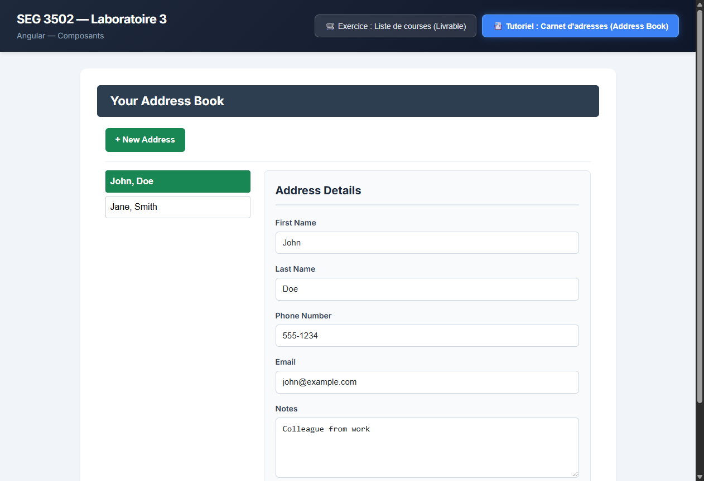

# SEG 3502 — Laboratoire 3 : Angular Standalone Components

Projet de laboratoire pour le cours **SEG 3502** portant sur le framework **Angular (v22)** avec composants autonomes (*Standalone Components*), formulaires template-driven (`[(ngModel)]`), communication inter-composants (`@Input()` / `@Output()`) et flux réactifs RxJS (`BehaviorSubject`).

---

## 👨‍💻 Étudiants
- **Anwar**
- **Manasse**
- **Dépôt GitHub :** [https://github.com/Anwarito-lbd/SEG3502-Lab3.git](https://github.com/Anwarito-lbd/SEG3502-Lab3.git)

---

## 📸 Aperçu & Captures d'écran

### 1. Exercice Évalué : Liste de courses (Shopping List)
Conforme au wireframe officiel avec encadrement, badges d'items arrondis bleus, boutons Supprimer et champ d'ajout :


### 2. Tutoriel du Laboratoire : Carnet d'adresses (Address Book)
Application complète issue des étapes guidées du laboratoire avec navigation par événements RxJS et édition protégée :


---

## 🏗️ Architecture du Projet

### A. Liste de courses (`src/app/shopping-list/`)
- **`ShoppingInputComponent` (`<app-shopping-input>`) :**
  - Saisie utilisateur avec `[(ngModel)]`
  - Validation contre les entrées vides
  - Émission de l'événement `@Output() itemAdded = new EventEmitter<string>()`
  - Ajout par clic sur `Ajouter` ou touche `Entrée`
- **`ShoppingListDisplayComponent` (`<app-shopping-list-display>`) :**
  - Réception de la collection via `@Input() items: string[]`
  - Transmission des suppressions via `@Output() itemDeleted = new EventEmitter<number>()`
  - Utilisation du nouveau contrôle de flux `@for (item of items; track $index)` avec `@empty`
- **`ShoppingItemComponent` (`<app-shopping-item>`) :**
  - Affichage de chaque ligne (badge bleu `.item-badge` et bouton `Supprimer`)
  - Émet `@Output() delete = new EventEmitter<number>()`
- **`ShoppingListComponent` (`<app-shopping-list>`) :**
  - Composant conteneur assemblant saisie et affichage
  - Bouton de réinitialisation de la liste par défaut
- **`ShoppingService` :**
  - Service injectable avec `BehaviorSubject<string[]>`
  - Initialisé avec `['5 pommes', '12 oeufs', '1 pain']`

### B. Carnet d'adresses (`src/app/address-book/`)
- **`AddressEntry` :** Modèle de données de contact (`firstName`, `lastName`, `phone`, `email`, `notes`)
- **`HeaderComponent` (`<app-header>`) :** En-tête de navigation
- **`AddressListElement` (`<app-address-list-element>`) :** Composant bouton pour chaque contact dans la barre latérale
- **`AddressView` (`<app-address-view>`) :** Formulaire de détails avec bascule `Edit` / `Protect`
- **`AddressList` (`<app-address-list>`) :** Conteneur de gestion des contacts
- **`NotificationService` :** Service de communication réactive avec `BehaviorSubject<AddressEntry | null>`

---

## 🧪 Tests Automatisés (Vitest)

Une suite complète de **31 tests unitaires** répartis sur 10 fichiers de test valide 100% du code :

```bash
npm test
```

Résultats :
- `shopping.service.spec.ts` (6 tests) — ✅ Passé
- `shopping-input.spec.ts` (4 tests) — ✅ Passé
- `shopping-item.spec.ts` (2 tests) — ✅ Passé
- `shopping-list-display.spec.ts` (3 tests) — ✅ Passé
- `shopping-list.spec.ts` (4 tests) — ✅ Passé
- `address-entry.spec.ts` (2 tests) — ✅ Passé
- `notification-service.spec.ts` (2 tests) — ✅ Passé
- `address-view.spec.ts` (3 tests) — ✅ Passé
- `address-list.spec.ts` (3 tests) — ✅ Passé
- `app.spec.ts` (2 tests) — ✅ Passé
- **Total : 31 tests passés (100%)**

---

## 🚀 Démarrage Rapide

```bash
# 1. Cloner le projet
git clone https://github.com/Anwarito-lbd/SEG3502-Lab3.git
cd SEG3502-Lab3

# 2. Installer les dépendances
npm install

# 3. Lancer le serveur de développement
npm start
# Rendez-vous sur http://localhost:4200

# 4. Lancer les tests unitaires
npm test

# 5. Compiler pour la production
npm run build
```
